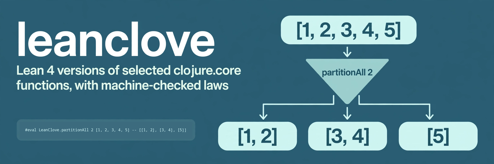

<p align="center">
  
</p>

<p align="center"><strong>clojure.core functions for Lean 4, with proofs</strong></p>

<p align="center">
  <a href="https://github.com/conao3/lean-leanclove/actions/workflows/ci.yml"></a>
  <a href="LICENSE"></a>
  <a href="lean-toolchain"></a>
  <a href="https://github.com/conao3/lean-leanclove/stargazers"></a>
</p>

<p align="center">
  <a href="#install">Install</a> |
  <a href="#functions-and-proofs">Functions and proofs</a> |
  <a href="#development">Development</a> |
  <a href="#license">License</a>
</p>

# leanclove

Lean 4 versions of selected `clojure.core` functions, with machine-checked laws.
LeanClove works on ordinary Lean lists, options, and hash maps, and depends only on Lean's standard library.

```lean
import LeanClove

#eval LeanClove.partitionAll 2 [1, 2, 3, 4, 5]  -- [[1, 2], [3, 4], [5]]
#eval LeanClove.reductions (· + ·) 0 [1, 2, 3]  -- [0, 1, 3, 6]
#eval LeanClove.get (LeanClove.frequencies ["a", "b", "a"]) "a"  -- some 2

example (n : Nat) (xs : List Nat) :
    LeanClove.take n xs ++ LeanClove.drop n xs = xs :=
  LeanClove.take_append_drop n xs
```

## Install

Use Lean `leanprover/lean4:v4.35.0`. Add the following to your project's `lakefile.toml`:

```toml
[[require]]
name = "leanclove"
git = "https://github.com/conao3/lean-leanclove.git"
rev = "main"
```

Run `lake update leanclove`, then `import LeanClove`. Pin `rev` to a commit for reproducible builds.

## Functions and proofs

| Area | Functions | Laws |
| --- | --- | --- |
| List access and construction | `first`, `rest`, `next`, `cons`, `conj`, `concat`, `last`, `butlast`, `nth` | Constructor/accessor laws, concatenation associativity, and absence on out-of-range indices |
| Slices and chunks | `take`, `drop`, `takeWhile`, `dropWhile`, `partition`, `partitionAll`, `interleave`, `interpose` | Take/drop reconstruction, chunk reconstruction and full chunk size, interleave and interpose lengths |
| Transformations and queries | `distinct`, `dedupe`, `mapcat`, `keep`, `mapIndexed`, `keepIndexed`, `reductions`, `some`, `every?`, `notAny?` | Distinct preserves membership without duplicates; reductions has one entry per prefix and ends at the fold result; append, length, and predicate laws |
| Finite generators | `iterate`, `repeat`, `range` | Each produces exactly the requested number of elements |
| Maps and aggregations | `get`, `assoc`, `dissoc`, `update`, `merge`, `selectKeys`, `zipmap`, `groupBy`, `frequencies` | Lookup laws, stable groups match filtered input, frequency lookup counts occurrences and all counts sum to the input length |
| Function helpers | `identity`, `constantly`, `comp`, `partial`, `complement`, `fnil`, `juxt` | Composition laws, partial application, double complement, fallback and length laws |

The functions are typed and eager, and work on finite values instead of Clojure's lazy sequences and dynamic runtime.
`first`, `next`, `last`, `nth`, and `get` use `Option` for absence. `keep` and `some` accept
`Option`-valued callbacks; they count `Option.some false` as a present result, where Clojure would treat `false` as falsey.
Predicates use `Bool`. `conj` prepends to lists, and `concat` and `interleave` are binary.
`partition` and `partitionAll` use non-overlapping chunks and return no chunks for size zero.
`partition` drops a short final chunk; `partitionAll` retains it.
`interleave` and `zipmap` stop at the shorter list; duplicate keys in `zipmap` use the last paired value.
`merge` is right-biased, and `update` passes the old value as an `Option`.
`range n` starts at zero, `iterate n f x` starts at the seed, and `reductions` takes an explicit initial value.
`comp` composes two functions, `partial` binds one argument, and `juxt` takes a homogeneous list of unary functions.

## Development

```sh
nix develop -c make check  # format check, reject proof placeholders, build, run Lean guards
nix build                  # build and test in the Nix sandbox
```

With Lean 4.35.0 on your `PATH`, you can also use `lake build` and `lake test` without Nix.

## License

[Apache License 2.0](LICENSE).
